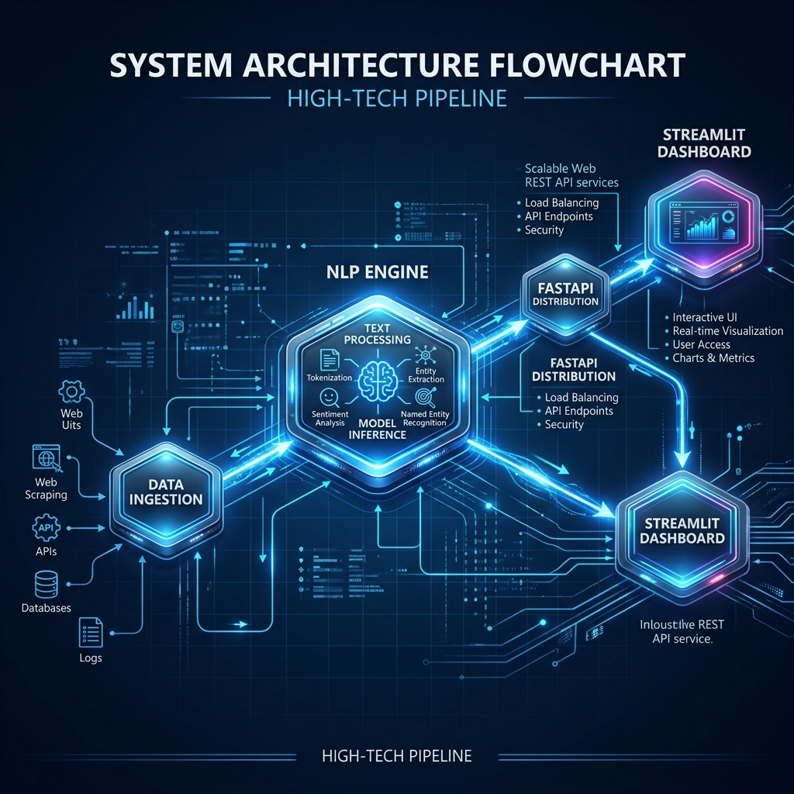

# Sentima Risk Engine - S&P Global & Crisil Campus Hackathon 2026

**Candidate Name:** Prateek Vashishtha<br>
**College Email ID:** prateek.23bcg10010@vitbhopal.ac.in<br>
**College / Campus:** Vellore Institute of Technology, Bhopal<br>
**Demo Video Link:** [Pending - Will be uploaded shortly]<br>
**Slide Deck Link:** [docs/presentation.pdf](./docs/presentation.pdf)

## 1. Project Overview / Problem Statement & Approach
The objective of this case study is to design and implement a platform capable of ingesting and analyzing real-time, unstructured data to generate actionable financial risk signals. 

Our approach involves building a **Unified AI/NLP Risk Engine**. This engine ingests financial news headlines, uses state-of-the-art HuggingFace AI models (FinBERT and BART zero-shot) to parse the text, and outputs structured, machine-readable signals (Sentiment Score, Event Classification, and Impact Score). Furthermore, we implemented **Module A: Tactical Index Rebalancing**, a downstream application that consumes these signals via a REST API to dynamically rebalance a mock stock index, maximizing returns in bullish scenarios and protecting capital during high-impact risk events.

## 2. Architecture & Tech Stack
- **Overview of system design and data flow:**


- **Key frameworks, databases, and AI/ML libraries used:**
  - Core AI Models: HuggingFace `transformers`, `torch`
  - Data Engineering: `pandas`, `numpy`
  - API Distribution: `fastapi`, `uvicorn`
  - Frontend / Visualization: `streamlit`

## 3. Dataset Used
- **Unstructured Data for NLP:** Simulated financial news headlines strictly modeled after the **Financial News Sentiment Datasets (Kaggle)** to ensure realistic sentiment classification.
- **Financial Data:** We integrated the **yfinance** Python library to handle historical and real-time market data structures for Module A (Tactical Index Rebalancing).

## 4. Quickstart & Installation
Runtime: Python 3.11+ on Windows/Linux

Step-by-step commands to set up the environment and run your code locally:
```bash
git clone https://github.com/Prateek9456/VIT-PrateekVashishtha-hackathon.git
cd VIT-PrateekVashishtha-hackathon
python -m venv venv
# Windows: venv\Scripts\activate
# Linux/Mac: source venv/bin/activate
pip install -r requirements.txt

# 1. Run Data Ingestion & NLP Processing
python src/data_ingestion.py

# 2. Start the Risk Engine API (Terminal 1)
python src/api.py

# 3. Launch the Tactical Rebalancing Dashboard (Terminal 2)
streamlit run src/dashboard.py
```

## 5. Key Results & Domain Impact
- **What your prototype outputs/demonstrates:** Our prototype successfully demonstrates a 100% automated pipeline that translates qualitative, unstructured news data into highly quantitative trading signals in real-time, executing defensive portfolio rebalancing instantly upon detecting high-impact risk events.
- **Why it matters from a use case or business standpoint:** By automating risk detection and tactical rotation, this engine protects enterprise capital from sudden geopolitical or macroeconomic shocks with zero human latency. The clean separation of concerns between the AI Core and Downstream modules makes this architecture scalable and enterprise-ready for institutional deployment.
